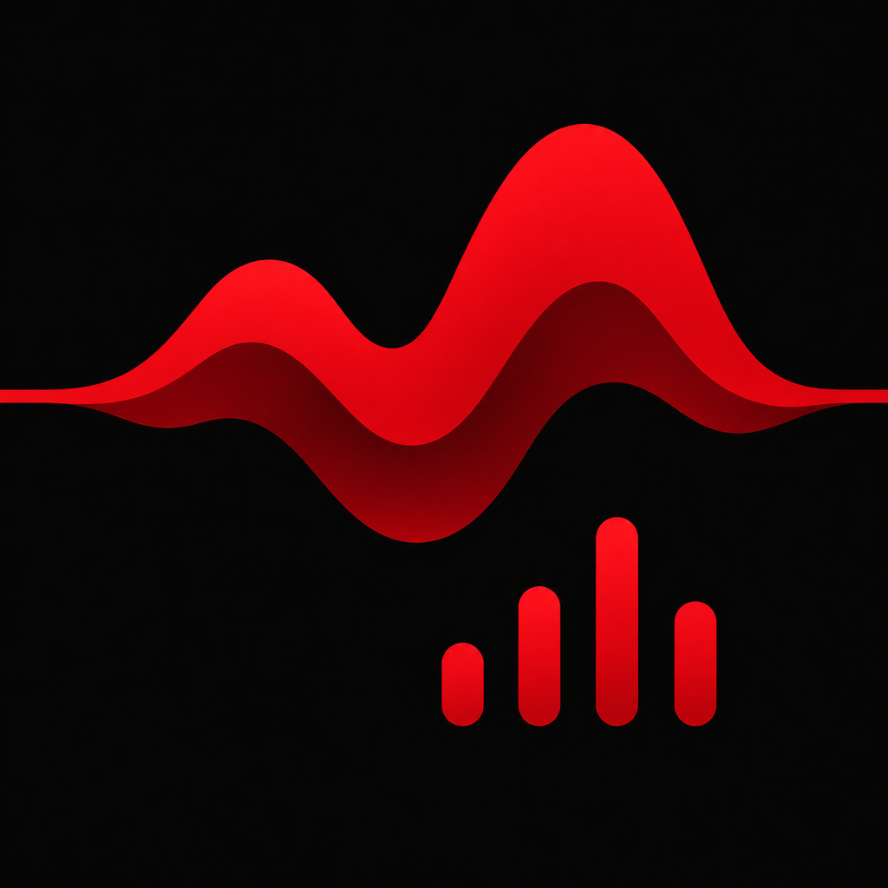

<div align="center">



# 🎵 Noir Player

**A sleek, lightweight Flutter music player** — play your local library, discover trending tracks, and download songs straight to your device.

<p>
  <a href="https://github.com/Abdullah-Masood-05/noir-music-player-android/releases/latest"></a>
  <a href="https://github.com/Abdullah-Masood-05/noir-music-player-android/releases/latest"></a>
  <a href="https://flutter.dev"></a>
  <a href="https://dart.dev"></a>
  
  <a href="LICENSE"></a>
  <a href="https://github.com/Abdullah-Masood-05/noir-music-player-android/stargazers"></a>
  <a href="https://github.com/Abdullah-Masood-05/noir-music-player-desktop"></a>
</p>

<p>
  <a href="https://github.com/Abdullah-Masood-05/noir-music-player-android/releases/latest"><b>📥 Download for Android or iPhone</b></a>
  &nbsp;·&nbsp;
  <a href="https://github.com/Abdullah-Masood-05/noir-music-player-desktop/releases/latest"><b>🖥️ Get it for desktop</b></a>
</p>

</div>

> ⭐ **Enjoying Noir Player?** If it's useful to you, please [star it on GitHub](https://github.com/Abdullah-Masood-05/noir-music-player-android). It's free and it helps other people find it.

---

## 📖 Contents

- [✨ Features](#-features)
- [📥 Download](#-download)
- [🧭 Discover](#-discover)
- [🖥️ Desktop version](#️-desktop-version)
- [🛠️ Building from source](#️-building-from-source)
- [🤝 Contributing](#-contributing)
- [📄 License](#-license)

---

## ✨ Features

- **Your music library**: songs, albums, artists and folders from your device, with search, playlists and Favourites.
- **Background playback**: keeps playing with the screen off. Title, artist and cover show in the notification, on the lock screen and in system media controls such as the Samsung Now Bar.
- **Discover**: browse trending songs or search for any song, then play it or download it. No account or API key needed.
- **Downloads with tags**: Discover downloads are saved as M4A at YouTube's original quality, with the album cover, title and artist inside the file.
- **Equalizer** with bands and presets.
- **Playback controls**: skip back / forward by your own interval (5–60 s or custom), 0.5×–2× speed without pitch change, a sleep timer, repeat and shuffle, and an Up Next queue.
- **Pauses for calls** and other interruptions, and resumes afterwards.
- **Dark, red-on-black design** with smooth animations.

---

## 📥 Download

Get the latest version from the **[Releases page](https://github.com/Abdullah-Masood-05/noir-music-player-android/releases/latest)**.
Each release has a `SHA256SUMS` file to check your download against.

### Android (7.0 or newer)

Download `NoirPlayer-vX.Y.Z.apk` on your phone, open it and tap **Install**. If Android asks, allow your
browser or file manager to install apps.

| File | For |
|---|---|
| `NoirPlayer-vX.Y.Z.apk` | Every phone. Pick this if you're unsure. |
| `NoirPlayer-vX.Y.Z-arm64-v8a.apk` | Most phones from the last few years (smaller download). |
| `NoirPlayer-vX.Y.Z-armeabi-v7a.apk` | Older 32-bit phones. |
| `NoirPlayer-vX.Y.Z-x86_64.apk` | Emulators and x86 Chromebooks. |
| `NoirPlayer-vX.Y.Z.aab` | App stores and `bundletool`; it can't be installed by tapping it. |

Updates install over the previous version and keep your playlists and settings. If you start with one of
the smaller per-processor APKs, keep updating with the same file. Coming from 1.1.x or older? Uninstall it
first: 1.2.0 and later are signed with a new key.

### iPhone / iPad

Download `NoirPlayer-iOS-vX.Y.Z-unsigned.ipa` and sideload it with **Sideloadly** or **AltStore**, which sign it
with your own Apple ID. See the [iOS build guide](docs/iOS_BUILD_GUIDE.md).

What changed in each version is in the [changelog](CHANGELOG.md).

---

## 🧭 Discover

Discover works out of the box.

- **Songs come straight from YouTube, found by your phone.** No server is in between, so there's no shared
  limit to run out of. Songs are looked up on YouTube Music first, so you get the official audio.
  - **Android** uses [NewPipe Extractor](https://github.com/TeamNewPipe/NewPipeExtractor), the library behind
    the NewPipe app.
  - **iPhone** uses [YouTubeKit](https://github.com/alexeichhorn/YouTubeKit). If it can't get a song,
    Discover falls back to Noir Player's server. This is new on iPhone; if a song won't play or download,
    please [open an issue](https://github.com/Abdullah-Masood-05/noir-music-player-android/issues) with
    the message the app showed.
- **Trending songs and search** come from Last.fm through Noir Player's server, the same one the desktop app
  uses.
- **Album covers** are looked up by song and artist on [Deezer](https://developers.deezer.com/api) and
  [iTunes Search](https://performance-partners.apple.com/search-api). Only the title and artist are sent.

Android saves downloads to your Music folder (you can pick another in Settings). iPhone saves them in the
app's own folder.

**Your own API keys (optional).** In **Settings → Discover** you can add your own keys. A service with a key
is called directly; the rest keep using the server. Keys are stored only on your device.

| Key | Used on | Get one from |
|---|---|---|
| Last.fm | Android and iPhone | [last.fm/api](https://www.last.fm/api/account/create) |
| YouTube Data API v3 | iPhone (fallback only) | [Google Cloud Console](https://console.cloud.google.com/apis/credentials) |
| RapidAPI | iPhone (fallback only) | [rapidapi.com](https://rapidapi.com/) |

Everything except Discover works offline.

---

## 🖥️ Desktop version

**[Noir Player for Desktop](https://github.com/Abdullah-Masood-05/noir-music-player-desktop)** brings the same
player and the same look to **Windows, macOS and Linux**. It's a separate app written in Rust, with folder
scanning, an equalizer, embedded lyrics, in-app updates and Discover.

<p>
  <a href="https://github.com/Abdullah-Masood-05/noir-music-player-desktop/releases/latest"><b>📥 Download for Windows, macOS or Linux</b></a>
</p>

---

## 🛠️ Building from source

You need **Flutter 3.50.0** (the version CI uses, with Dart 3.14) and JDK 21 for Android builds.

```bash
git clone https://github.com/Abdullah-Masood-05/noir-music-player-android.git
cd noir-music-player-android
flutter pub get
flutter run
```

Release builds:

```bash
flutter build apk --release                  # universal APK
flutter build apk --release --split-per-abi  # one APK per processor type
flutter build appbundle --release            # App Bundle
```

iOS builds need a Mac with Xcode and use Swift Package Manager (on by default since Flutter 3.44), because
YouTubeKit is only published as a Swift package. See the [iOS build guide](docs/iOS_BUILD_GUIDE.md).

**CI and releases.** GitHub Actions runs `flutter analyze` and `flutter test` on every push, then builds the
Android APKs and App Bundle (`ci.yml`) and an unsigned iOS IPA (`ios.yml`). Pushing a tag `vX.Y.Z` that matches
`version:` in `pubspec.yaml` runs `release.yml`, which publishes those builds with checksums and the notes from
[`CHANGELOG.md`](CHANGELOG.md). Android builds are release-signed when the `ANDROID_KEYSTORE_BASE64`,
`ANDROID_KEYSTORE_PASSWORD`, `ANDROID_KEY_ALIAS` and `ANDROID_KEY_PASSWORD` secrets are set.

<details>
<summary><b>Main dependencies</b></summary>

| Package | Purpose |
|---|---|
| [`just_audio`](https://pub.dev/packages/just_audio) · [`audio_service`](https://pub.dev/packages/audio_service) · [`audio_session`](https://pub.dev/packages/audio_session) | Playback, background service, notification and audio focus |
| [`on_audio_query`](https://pub.dev/packages/on_audio_query) | The device's music library and artwork |
| [`flutter_riverpod`](https://pub.dev/packages/flutter_riverpod) · [`shared_preferences`](https://pub.dev/packages/shared_preferences) | State and saved settings |
| [`http`](https://pub.dev/packages/http) · [`cached_network_image`](https://pub.dev/packages/cached_network_image) | Networking and cached Discover artwork |
| [`permission_handler`](https://pub.dev/packages/permission_handler) · [`path_provider`](https://pub.dev/packages/path_provider) | Permissions and folders |
| [`flutter_animate`](https://pub.dev/packages/flutter_animate) | Animations |
| [NewPipe Extractor](https://github.com/TeamNewPipe/NewPipeExtractor) · [OkHttp](https://square.github.io/okhttp/) | Discover on Android |
| [YouTubeKit](https://github.com/alexeichhorn/YouTubeKit) | Discover on iPhone |

</details>

---

## 🤝 Contributing

Pull requests are welcome. For bigger changes, please [open an issue](https://github.com/Abdullah-Masood-05/noir-music-player-android/issues)
first so we can talk it through. Bug reports and ideas are welcome there too, or in
[Discussions](https://github.com/Abdullah-Masood-05/noir-music-player-android/discussions).

---

## 📄 License

Noir Player's own code is under the **MIT License**. See [LICENSE](LICENSE).

The Android app includes [NewPipe Extractor](https://github.com/TeamNewPipe/NewPipeExtractor) and code from the
[NewPipe](https://github.com/TeamNewPipe/NewPipe) app, both GPL-3.0: the MP4 muxer under
`android/app/src/main/java/org/schabi/newpipe/streams/` and `android/app/src/main/java/us/shandian/giga/io/`,
and `NewPipeDownloader.kt`. Those files stay under the GPL-3.0, and Android builds (APK / AAB) as a whole are
distributed under the **GPL-3.0**; their complete source is this repository.

The iPhone app uses [YouTubeKit](https://github.com/alexeichhorn/YouTubeKit) (MIT).

---

<div align="center">

**🎧 Enjoy the music with Noir Player!**

📱 Android · iOS · 🖥️ [Windows, macOS & Linux](https://github.com/Abdullah-Masood-05/noir-music-player-desktop)

</div>
